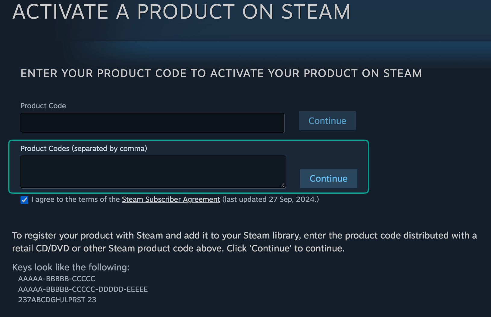
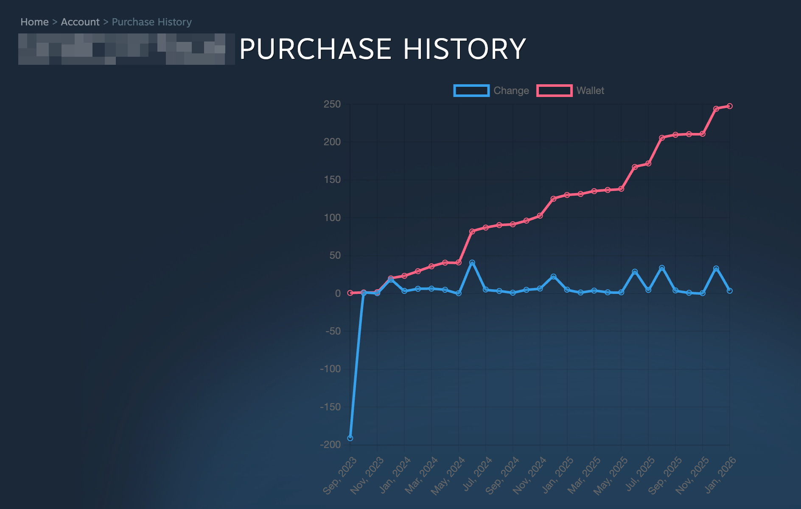
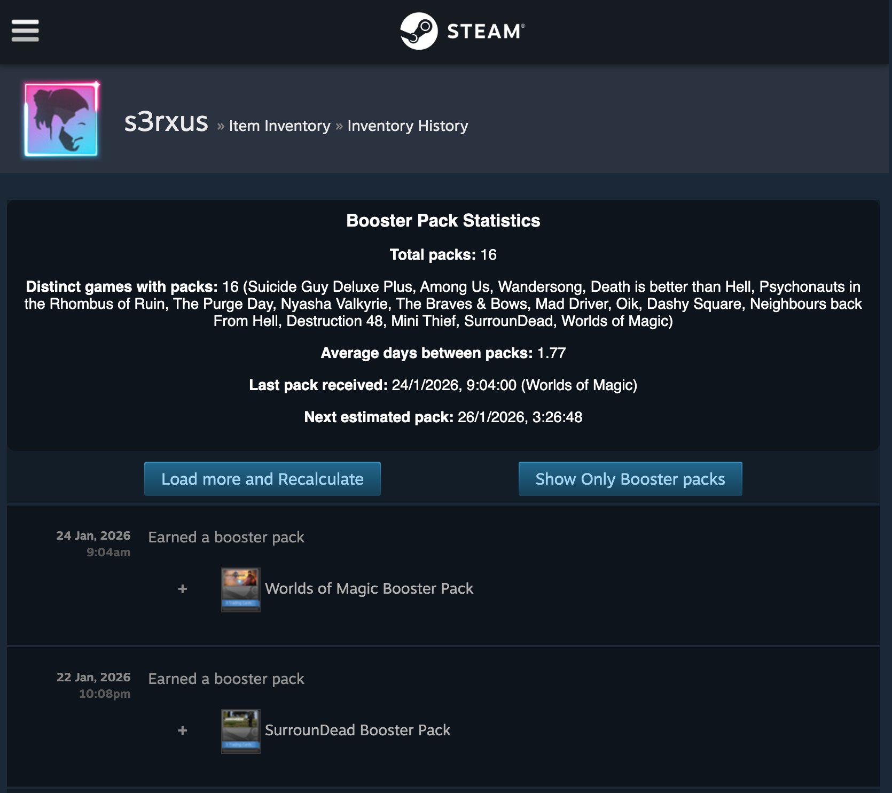
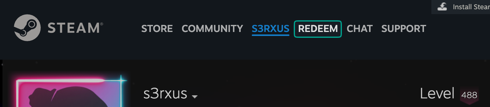
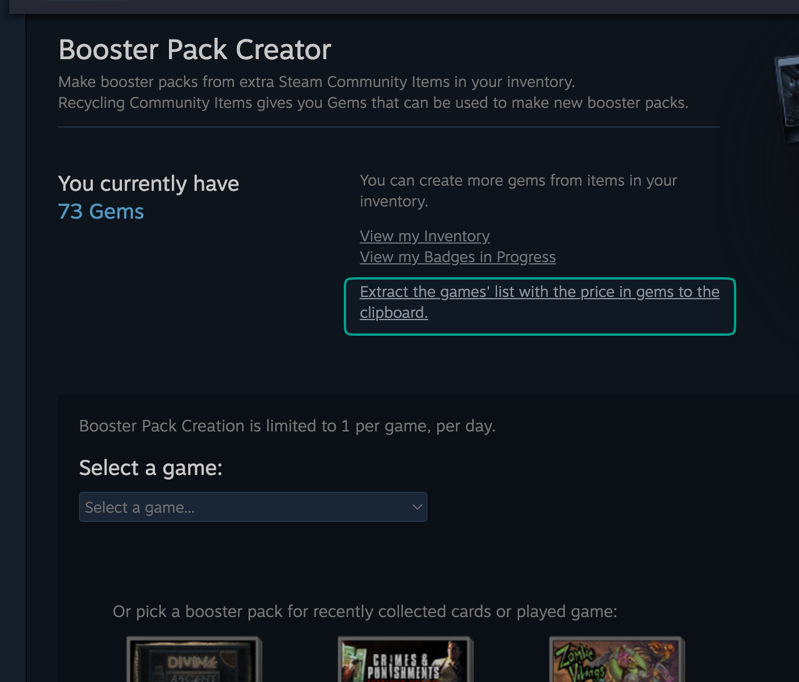
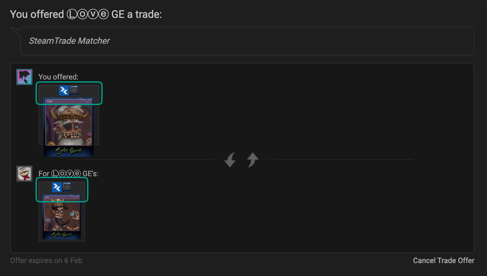
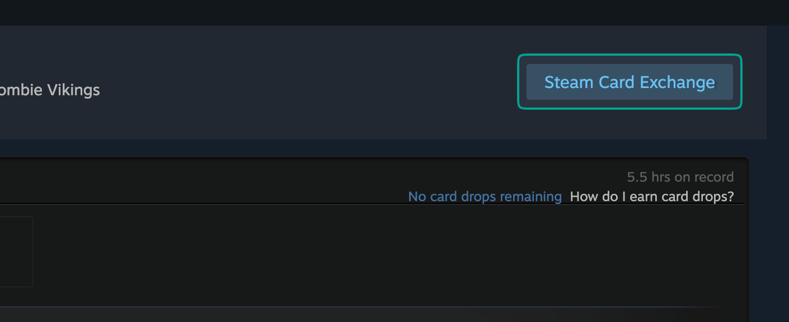
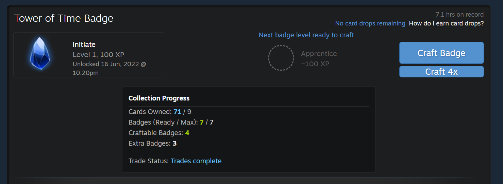

# ✨ Steam Enhanced

**Steam Enhanced** is a browser userscript designed to enrich your experience on the [Steam](https://store.steampowered.com/) platform by adding quality-of-life enhancements, tools, and visual insights.

---

## 🚀 Features

- **Bulk Key Activation:** Redeem multiple product keys at once (separated by commas) on the [Register Key Page](https://store.steampowered.com/account/registerkey).
- **Wallet Balance Chart:** Visual graph tracking your wallet balance over time in the [Purchase History Page](https://store.steampowered.com/account/history/).
- **Quick Redeem Navigation:** Adds a direct key redemption link button to the top navigation bar across all Steam pages.
- **Booster Pack Analyzer:** Direct analytics and summary for booster packs earned in your [Inventory History Page](https://steamcommunity.com/my/inventoryhistory).
- **SteamTrade Matcher Integration:**
    - Adds links to **SteamTrade Matcher** and relevant badge pages directly within [Trade Offers](https://steamcommunity.com/my/tradeoffers/).
    - Quick STM links on individual [Game Badge Pages](https://steamcommunity.com/my/badges/).
- **Gems Price Exporter:** Easily extract and copy all booster pack creation costs in gems from the [Booster Pack Creator](https://steamcommunity.com/tradingcards/boostercreator).
- **Badge Tracker:** Displays a collection progress panel directly on game card pages.

---

## ⚙️ Prerequisites

Before installing, make sure you have a compatible userscript manager installed in your browser:

- **Chrome / Edge / Brave:** [Tampermonkey](https://www.tampermonkey.net/) or [Violentmonkey](https://violentmonkey.github.io/)
- **Firefox:** [Greasemonkey](https://www.greasespot.net/) or [Tampermonkey](https://www.tampermonkey.net/)
- **Opera:** [Violentmonkey](https://addons.opera.com/en/extensions/details/violent-monkey/)

---

## 📦 Installation

1. Open your userscript extension dashboard.
2. Click to view the raw userscript file:  
   👉 **[Install `steam-enhanced.user.js`](https://raw.githubusercontent.com/sergiosusa/steam-enhanced/main/steam-enhanced.user.js)** *(update path if different)*
3. Your browser extension will automatically prompt you to install it.
4. Click **Install** or **Confirm**.

---

## 🖼️ Screenshots

| Feature | Preview |
| :--- | :--- |
| **Multiple Key Activation** |  |
| **Purchase History Chart** |  |
| **Booster Pack Analyzer** |  |
| **Top Menu Redeem Button** |  |
| **Booster Prices in Gems** |  |
| **Trade Offers Integration** |  |
| **Badge Page Integration** |  |
| **Collection Progress Panel** |  |

---

## ☕ Support My Work

If you find this script helpful, consider supporting its development or starring the repository!

